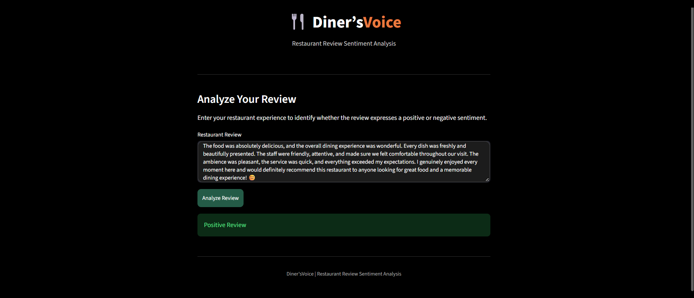
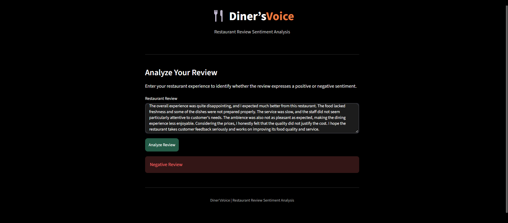

# 🍽️ Diner'sVoice – Restaurant Review Sentiment Analysis

## Overview
Diner'sVoice is a Natural Language Processing (NLP) based application that analyzes restaurant reviews and identifies whether the given review expresses a positive or negative sentiment.

The application uses machine learning and text preprocessing techniques to transform customer reviews into meaningful sentiment predictions.

## Features
- Enter restaurant reviews and analyze their sentiment.
- Predict positive and negative customer opinions.
- Text preprocessing using NLTK.
- TF-IDF vectorization for text feature extraction.
- Machine learning-based sentiment classification.
- Interactive web interface built with Streamlit.

## Technologies Used
- Python
- Natural Language Processing (NLP)
- NLTK
- Scikit-learn
- TF-IDF Vectorization
- Streamlit
- Joblib
- Pandas

## Project Structure
```text
DinersVoice/
│
├── app.py
├── models/
│   └── nlp_model.pkl
├── data/
│   └── output.csv
├── sample.ipynb
├── requirements.txt
├── README.md
└── .gitignore
```

## How to Run

1. Clone the repository:
```bash
git clone https://github.com/Jyothisreek123/DinersVoice.git
```

2. Navigate to the project directory:
```bash
cd DinersVoice
```

3. Install the required libraries:
```bash
pip install -r requirements.txt
```

4. Run the Streamlit application:
```bash
streamlit run app.py
```
## Application Screenshots

### Positive Sentiment Prediction



### Negative Sentiment Prediction




